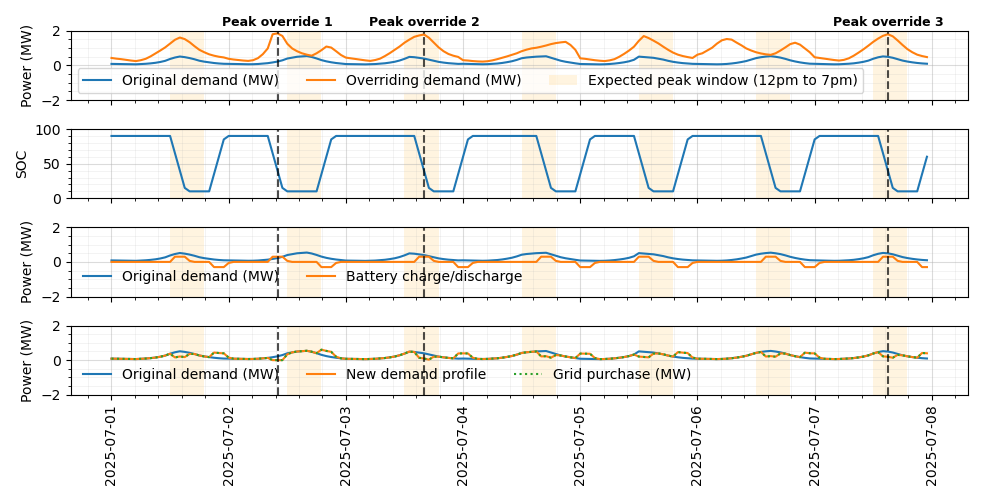

---
jupytext:
  text_representation:
    extension: .md
    format_name: myst
    format_version: 0.13
    jupytext_version: 1.18.1
kernelspec:
  display_name: Python 3.11.13 ('h2i_env')
  language: python
  name: python3
---

(open-loop-control)=
# Open-Loop Controllers

## Open-Loop Storage Controllers
The open-loop storage controllers can be attached as the control strategy in the `tech_config` for various storage components (e.g., battery or hydrogen storage). There are three controller types for storage:
1. [Simple Open-Loop Storage Controller](#pass-through-controller) — commands the difference between demand and incoming commodity.
2. [Demand Open-Loop Storage Controller](#demand-open-loop-storage-controller) — uses simple logic to attempt to meet demand using the storage technology.
3. [Peak Load Management Open-Loop Storage Controller](#peak-load-management-open-loop-storage-controller) — computes a peak-shaving dispatch schedule to reduce demand peaks, supporting one or two demand profiles with configurable event limits and time windows.

(pass-through-controller)=
### Simple Open-Loop Storage Controller
{py:class}`~h2integrate.control.control_strategies.storage.simple_openloop_controller.SimpleStorageOpenLoopController`,
configured by
{py:class}`~h2integrate.control.control_strategies.storage.simple_openloop_controller.SimpleStorageOpenLoopControllerConfig`,
sets `{commodity}_command_value` to `{commodity}_set_point` minus `{commodity}_in`. Negative
commands charge storage and positive commands discharge it. When configured to use average input
as demand, it substitutes the mean of `{commodity}_in` for the set-point.

For examples of how to use the `SimpleStorageOpenLoopController` open-loop control framework, see the following:
- `examples/01_onshore_steel_mn`
- `examples/02_texas_ammonia`
- `examples/12_ammonia_synloop`

(demand-open-loop-storage-controller)=
### Demand Open-Loop Storage Controller
{py:class}`~h2integrate.control.control_strategies.storage.demand_openloop_storage_controller.DemandOpenLoopStorageController`,
configured by
{py:class}`~h2integrate.control.control_strategies.storage.demand_openloop_storage_controller.DemandOpenLoopStorageControllerConfig`,
dispatches storage when demand exceeds generation and charges it when generation exceeds demand.
It takes `{commodity}_in`, `{commodity}_set_point`, and storage capacity and rate inputs, and
outputs `{commodity}_command_value`. Its state of charge is estimated in the controller and is not
fed back from the storage performance model. Both the simple and demand controllers require
one-hour time steps.

An interactive example of an N2 diagram for a system using the open-loop control framework for hydrogen storage and dispatch is shown below.

Open `h2i_n2.html` in a browser to explore model groups, components, and variable connections.

```{code-cell} ipython3
:tags: [remove-input]

from h2integrate import H2IntegrateModel
import openmdao.api as om
import os

import html
from pathlib import Path
from IPython.display import HTML, display

# Change to an example directory
os.chdir("../../../examples/14_wind_hydrogen_dispatch/")

# Build and set up the model
h2i_model = H2IntegrateModel("inputs/h2i_wind_to_h2_storage.yaml")
h2i_model.setup()

# Write interactive N2 HTML diagram
om.n2(
    h2i_model.prob,
    outfile="h2i_n2.html",
    display_in_notebook=False, # set to True to display in-line in a notebook
    show_browser=False, # set to True to open in a browser at run time
)

n2_html = "h2i_n2.html"
n2_srcdoc = html.escape(Path(n2_html).read_text(encoding="utf-8"))
display(
    HTML(
        f'<div style="width:100%; height:600px; overflow:auto; margin:0; padding:0; border:0;">'
        f'<iframe srcdoc="{n2_srcdoc}" '
        'style="display:block; width:200%; height:600px; border:0; margin:0; padding:0; background:transparent;" '
        'loading="lazy"></iframe>'
        '</div>'
    )
)
```

For examples of how to use the `DemandOpenLoopStorageController` open-loop control framework, see the following:
- `examples/14_wind_hydrogen_dispatch/`
- `examples/19_simple_dispatch/`

(peak-load-management-open-loop-storage-controller)=
### Peak Load Management Open-Loop Storage Controller
The `PeakLoadManagementHeuristicOpenLoopStorageController` computes and executes a peak-shaving dispatch schedule assuming perfect forecasting. It is designed for reducing peak loads, not meeting a specific demand, using either one or two loads for determining peaks.
See
{py:class}`~h2integrate.control.control_strategies.storage.plm_openloop_storage_controller.PeakLoadManagementHeuristicOpenLoopStorageController`
and
{py:class}`~h2integrate.control.control_strategies.storage.plm_openloop_storage_controller.PeakLoadManagementHeuristicOpenLoopStorageControllerConfig`.

The controller's configuration is:

```{eval-rst}
.. autoclass:: h2integrate.control.control_strategies.storage.plm_openloop_storage_controller.PeakLoadManagementHeuristicOpenLoopStorageControllerConfig
   :members:
   :no-index:
   :inherited-members: OpenLoopControlBaseConfig, BaseConfig
   :exclude-members: require_storage_parameters, demand_profile_upstream, dispatch_priority_demand_profile, n_override_events, override_events_period, peak_range, advance_discharge_period, delay_charge_period, allow_charge_in_peak_range, min_peak_proximity
```

```{note}
The algorithm currently only supports daily cycles, but could be adjusted to accommodate alternate cycle rates.
```

The controller supports two demand profiles:

- **`demand_profile`** — the local or sub-system demand. Peaks within a configurable daily time window (`peak_range`) are identified as candidate discharge targets.
- **`demand_profile_upstream`** — an optional upstream or supervisory demand. When provided, an operator can override the local peak schedule up to a configurable number of events per period (e.g., three times per week). Peaks are determined as the highest n peaks in each period.

The `dispatch_priority_demand_profile` parameter selects which profile acts as the override schedule. On days where the priority profile flags a peak (up to n override instances in the given time period), the controller follows that schedule; on all other days it falls back to the other profile.

**Dispatch logic (state machine)**

1. **Discharge** — begins `advance_discharge_period` before the next scheduled peak and runs until `min_soc_fraction` is reached.
2. **Charge** — resumes after `delay_charge_period` has elapsed since the end of discharge, subject to the `allow_charge_in_peak_range` flag which can block recharging during the peak windows.
3. **Idle** — all other timesteps; set-point is zero.

An example output for the first week of a one-year simulation is shown below. Orange shading marks the 12:00–19:00 daily peak window. The top panel shows both demand profiles; the second panel shows battery state of charge; the third shows battery charge/discharge power; the fourth shows the resulting net demand. Periods where `demand_profile_upstream` takes precedence are marked with vertical dashed lines (three occurrences in the week shown). Note that where `demand_profile_upstream` does not override, the peaks in `demand_profile` are reduced.



For an example of how to use the `PeakLoadManagementHeuristicOpenLoopStorageController`, see:
- `examples/33_peak_load_management_heuristics/plm_storage/`

For API details, see the [`PeakLoadManagementHeuristicOpenLoopStorageController` API documentation](../../_autosummary/h2integrate.control.control_strategies.storage.plm_openloop_storage_controller).

## Open-Loop Converter Controllers
The open-loop converter controllers can be attached as the control strategy in the `tech_config` for converter technologies (e.g., a fuel cell). Unlike the storage controllers, converter controllers do not track a state of charge; they translate a set-point into a `{commodity}_command_value` that is bounded by the converter's rated production. There is currently one converter controller:
1. [Peak Load Management Open-Loop Converter Controller](#peak-load-management-open-loop-converter-controller) — computes a peak-shaving converter command from one or two demand profiles using simple threshold heuristics.

(peak-load-management-open-loop-converter-controller)=
### Peak Load Management Open-Loop Converter Controller
The `PLMHeuristicOpenLoopConverterController` computes a per-timestep converter command that shaves demand peaks using threshold-based heuristics rather than storage state-of-charge dynamics or optimization. It is designed for dispatching a converter (such as a fuel cell) to reduce peak loads using either one or two demand profiles.
See
{py:class}`~h2integrate.control.control_strategies.converters.plm_openloop_converter_controller.PLMHeuristicOpenLoopConverterController`
and
{py:class}`~h2integrate.control.control_strategies.converters.plm_openloop_converter_controller.PLMHeuristicOpenLoopConverterControllerConfig`.

The command at each timestep is determined by three limits:

- **A primary set-point cutoff (`demand_profile_peak_cutoff`)** — dispatch is only considered when the local `{commodity}_set_point` exceeds this threshold. The desired dispatch is the amount by which the set-point exceeds the cutoff.
- **An optional upstream signal and cutoff (`demand_profile_upstream` and `demand_profile_upstream_peak_cutoff`)** — a supervisory or upstream signal that can also trigger or shape dispatch. Its interpretation is controlled by `demand_profile_upstream_kind`:
  - `"commodity"` (default) — the upstream signal is an upstream demand in commodity-amount units. The command tracks the larger exceedance of the local and upstream profiles.
  - `"price"` — the upstream signal is a price time series. Dispatch is only enabled on timesteps where the upstream price exceeds `demand_profile_upstream_peak_cutoff`.
- **A converter capacity ceiling** — the command is clipped so it never exceeds the converter's `rated_{commodity}_production` (read from the performance model) or the instantaneous local demand.

Because the controller reads the performance model's `rated_{commodity}_production` output as its command ceiling, a solver is automatically added at the technology group level to converge the controller/performance-model coupling.

The controller's configuration is:

```{eval-rst}
.. autoclass:: h2integrate.control.control_strategies.converters.plm_openloop_converter_controller.PLMHeuristicOpenLoopConverterControllerConfig
   :members:
   :no-index:
```

For an example of how to use the `PLMHeuristicOpenLoopConverterController`, see:
- `examples/33_peak_load_management_heuristics/plm_converter/`

For API details, see the [`PLMHeuristicOpenLoopConverterController` API documentation](../../_autosummary/h2integrate.control.control_strategies.converters.plm_openloop_converter_controller).
