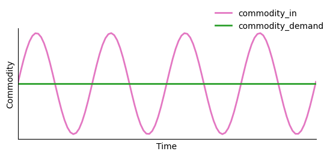
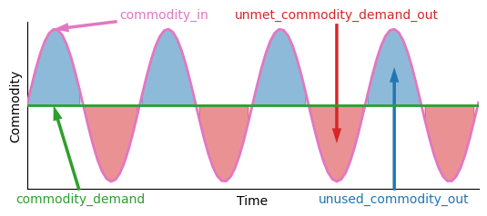
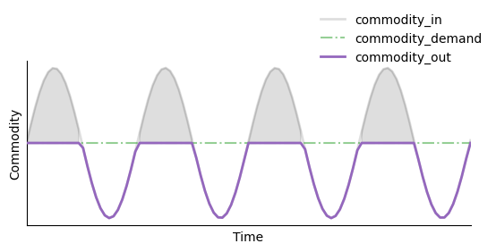
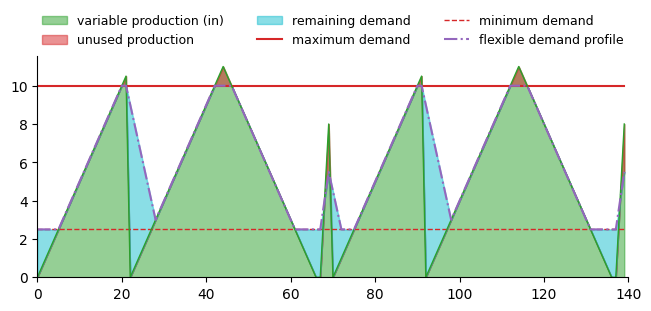

# Demand Components

Demand components define rule-based logic for meeting commodity demand profiles without dynamic
system feedback. The generic component compares supply and demand per timestep; the flexible
component also considers ramping and utilization across the simulation.

This page documents two core demand types:
1. {py:class}`~h2integrate.demand.generic_demand.GenericDemandComponent` meets a fixed demand profile.
2. {py:class}`~h2integrate.demand.flexible_demand.FlexibleDemandComponent` adjusts demand within flexible bounds.


(demand-component-inputs-and-outputs)=
## Demand component inputs and outputs
The inputs to the demand components are the `{commodity}_demand` profile and the `{commodity}_in` profile. The `{commodity}_in` profile is the initial commodity used to satisfy the demand. Suppose the `{commodity}_in` (pink) and `{commodity}_demand` (green) profiles look like whats shown below:



The demand components then compute the following output profiles:
- `unmet_{commodity}_demand_out`: Unmet demand (non-zero when supply < demand, otherwise 0.)
- `unused_{commodity}_out`: Unused commodity (non-zero when supply > demand, otherwise 0.)



- `{commodity}_out`: Delivered output (commodity supplied to demand sink)



The demand components also compute the following outputs:
- `capacity_factor`: the ratio of the demand that's been met to the full demand
- `rated_{commodity}_production`: the mean value of the demand profile used in the calculation
- `total_{commodity}_produced` and `annual_{commodity}_produced`: delivered commodity over the
  simulation and its annualized value
- `percent_load_missed` and `curtailment_percent`: aggregate unmet demand and unused supply


(generic-demand-component)=
### Generic Demand Component
The `GenericDemandComponent` allocates commodity input to meet a defined demand profile. It does not contain energy storage logic, only **instantaneous** matching of supply and demand.
Its configuration class is {py:class}`~h2integrate.demand.demand_baseclass.DemandComponentBaseConfig`.
It supports one-hour time steps and can be stepped.

The demand component computes each value per timestep:
- Unmet demand (non-zero when supply < demand, otherwise 0.)
- Unused commodity (non-zero when supply > demand, otherwise 0.)
- Delivered output (commodity supplied to demand sink)

This provides a simple baseline for understanding supply–demand balance.

#### Configuration
Define demand in `tech_config` using the following configuration:

```{eval-rst}
.. autoclass:: h2integrate.demand.demand_baseclass.DemandComponentBaseConfig
   :members:
   :no-index:
```

```yaml
performance_model:
    model: GenericDemandComponent
model_inputs:
  performance_parameters:
    commodity: hydrogen
    commodity_rate_units: kg/h
    demand_profile: [10, 10, 12, 15, 14]
```
For an example of how to use the `GenericDemandComponent` framework, see the following:
- `examples/23_solar_wind_ng_demand`

(flexible-demand-component)=
### Flexible Demand Component
The `FlexibleDemandComponent` extends the generic demand component by allowing the actual demand to flex up or down within defined bounds. This is useful for demand-side management scenarios where:
- Processes can defer demand (e.g., flexible industrial loads)
- The system requires demand elasticity without dynamic optimization

It uses {py:class}`~h2integrate.demand.flexible_demand.FlexibleDemandComponentConfig` and
supports one-hour time steps. If configured `min_utilization` is 1, the baseline demand is used
without flexible adjustments.

The component computes:
- Flexible demand (clamped within allowable ranges)
- Unmet flexible demand
- Unused commodity
- Delivered output

For an example of how to use the `FlexibleDemandComponent` demand component, see the following:
- `examples/23_solar_wind_ng_demand`

The flexible demand component takes an input commodity production profile, the maximum demand profile, and various constraints (listed below), and creates a "flexible demand profile" that follows the original input commodity production profile while satisfying varying constraint.
The profile is output as `{commodity}_flexible_demand_profile`. The bounds and ramp limits use
the first value of the `rated_{commodity}_demand` input, which defaults to the first value of
`demand_profile`. The required `rated_demand` configuration field is currently not used to set
that input. Minimum utilization is evaluated relative to this rated value times the number of
timesteps.
Please see the figure below for an example of how the flexible demand profile can vary from the original demand profile based on the input commodity production profile and the ramp rates.
The axes are unlabeled to allow for generalization to any commodity and unit type.

|  |
|-|


#### Configuration
Flexible demand extends the [generic demand configuration](#generic-demand-component):

```{eval-rst}
.. autoclass:: h2integrate.demand.flexible_demand.FlexibleDemandComponentConfig
   :members:
   :no-index:
```

```yaml
model_inputs:
  performance_parameters:
    commodity: hydrogen
    commodity_rate_units: kg/h
    demand_profile: [10, 12, 10, 8]
    rated_demand: 10
    turndown_ratio: 0.1
    ramp_down_rate_fraction: 0.5
    ramp_up_rate_fraction: 0.5
    min_utilization: 0
```
